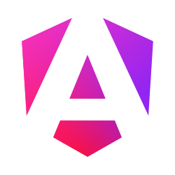

  

<h3 align="center">Consulo — free open-source multi-language IDE</h3>

  One IDE for many language stacks. Started in 2013 as a fork of <a href="https://github.com/JetBrains/intellij-community">IntelliJ IDEA Community Edition</a>.

  
  
  
   
  
  
  

---

### 🧩 Platform

<table>
  <tr>
    <td width="90" align="center"></td>
    <td width="870">
      <a href="https://github.com/consulo/consulo"><b>Consulo</b></a> — main IDE repository 
      <a href="https://github.com/consulo/consulo-dap">Debug Adapter Protocol</a> ·
      <a href="https://github.com/consulo/consulo-devkit">DevKit</a> ·
      <a href="https://github.com/consulo/maven-consulo-plugin">Maven codegen & runner plugin</a> ·
      <a href="https://github.com/consulo/consulo-simple-plugin-template">Plugin template</a>
    </td>
  </tr>
</table>

### 🔌 Main plugins

Each language is a separate plugin with its own repository — report issues there.

<table>
  <tr>
    <td width="64" align="center"><picture><source media="(prefers-color-scheme: dark)" srcset="https://raw.githubusercontent.com/consulo/.github/refs/heads/master/profile/icons/group-jvm_dark.svg"></picture></td>
    <td width="260" valign="top">
      <picture><source media="(prefers-color-scheme: dark)" srcset="https://raw.githubusercontent.com/consulo/.github/refs/heads/master/profile/icons/java_dark.svg"></picture> <a href="https://github.com/consulo/consulo-java">Java</a> 
      &nbsp;&nbsp;&nbsp;&nbsp;&nbsp;&nbsp;<picture><source media="(prefers-color-scheme: dark)" srcset="https://raw.githubusercontent.com/consulo/.github/refs/heads/master/profile/icons/spring_dark.svg"></picture> <a href="https://github.com/consulo/consulo-spring">Spring</a> 
      &nbsp;&nbsp;&nbsp;&nbsp;&nbsp;&nbsp;<picture><source media="(prefers-color-scheme: dark)" srcset="https://raw.githubusercontent.com/consulo/.github/refs/heads/master/profile/icons/hibernate_dark.svg"></picture> <a href="https://github.com/consulo/consulo-hibernate">Hibernate</a> 
      &nbsp;&nbsp;&nbsp;&nbsp;&nbsp;&nbsp; <a href="https://github.com/consulo/consulo-jakarta-persistence">Jakarta Persistence</a> 
      &nbsp;&nbsp;&nbsp;&nbsp;&nbsp;&nbsp; <a href="https://github.com/consulo/consulo-jakarta-web">JSP & Servlet</a> 
       <a href="https://github.com/consulo/consulo-groovy">Groovy</a> 
      <picture><source media="(prefers-color-scheme: dark)" srcset="https://raw.githubusercontent.com/consulo/.github/refs/heads/master/profile/icons/maven_dark.svg"></picture> <a href="https://github.com/consulo/consulo-maven">Maven</a> 
      <picture><source media="(prefers-color-scheme: dark)" srcset="https://raw.githubusercontent.com/consulo/.github/refs/heads/master/profile/icons/gradle_dark.svg"></picture> <a href="https://github.com/consulo/consulo-gradle">Gradle</a> 
    </td>
    <td width="64" align="center"><picture><source media="(prefers-color-scheme: dark)" srcset="https://raw.githubusercontent.com/consulo/.github/refs/heads/master/profile/icons/group-dotnet_dark.svg"></picture></td>
    <td width="260" valign="top">
       <a href="https://github.com/consulo/consulo-dotnet-core">.NET</a> 
       <a href="https://github.com/consulo/consulo-dotnet-microsoft">.NET Framework</a> 
      <picture><source media="(prefers-color-scheme: dark)" srcset="https://raw.githubusercontent.com/consulo/.github/refs/heads/master/profile/icons/dotnet-mono_dark.svg"></picture> <a href="https://github.com/consulo/consulo-dotnet-mono">Mono</a> 
       <a href="https://github.com/consulo/consulo-csharp">C#</a> 
       <a href="https://github.com/consulo/consulo-fsharp">F#</a> 
       <a href="https://github.com/consulo/consulo-visual-basic-net">Visual Basic</a> 
       <a href="https://github.com/consulo/consulo-msbuild">MSBuild</a> 
      &nbsp; 
    </td>
    <td width="64" align="center"><picture><source media="(prefers-color-scheme: dark)" srcset="https://raw.githubusercontent.com/consulo/.github/refs/heads/master/profile/icons/group-native_dark.svg"></picture></td>
    <td width="260" valign="top">
      <picture><source media="(prefers-color-scheme: dark)" srcset="https://raw.githubusercontent.com/consulo/.github/refs/heads/master/profile/icons/native-dev_dark.svg"></picture> <a href="https://github.com/consulo/consulo-native-dev">Native Development</a> 
      &nbsp;&nbsp;&nbsp;&nbsp;&nbsp;&nbsp;<picture><source media="(prefers-color-scheme: dark)" srcset="https://raw.githubusercontent.com/consulo/.github/refs/heads/master/profile/icons/native-dev_dark.svg"></picture> <a href="https://github.com/consulo/consulo-cpp">C/C++</a> 
      &nbsp;&nbsp;&nbsp;&nbsp;&nbsp;&nbsp;<picture><source media="(prefers-color-scheme: dark)" srcset="https://raw.githubusercontent.com/consulo/.github/refs/heads/master/profile/icons/rust_dark.svg"></picture> <a href="https://github.com/consulo/consulo-rust">Rust</a> 
      &nbsp;&nbsp;&nbsp;&nbsp;&nbsp;&nbsp; <a href="https://github.com/consulo/consulo-google-go">Go</a> 
      &nbsp;&nbsp;&nbsp;&nbsp;&nbsp;&nbsp;<picture><source media="(prefers-color-scheme: dark)" srcset="https://raw.githubusercontent.com/consulo/.github/refs/heads/master/profile/icons/d_dark.svg"></picture> <a href="https://github.com/consulo/consulo-d">D</a> 
      &nbsp;&nbsp;&nbsp;&nbsp;&nbsp;&nbsp; <a href="https://github.com/consulo/consulo-zig">Zig</a> 
      &nbsp;&nbsp;&nbsp;&nbsp;&nbsp;&nbsp;<picture><source media="(prefers-color-scheme: dark)" srcset="https://raw.githubusercontent.com/consulo/.github/refs/heads/master/profile/icons/swift_dark.svg"></picture> <a href="https://github.com/consulo/consulo-swift">Swift</a> 
      &nbsp;&nbsp;&nbsp;&nbsp;&nbsp;&nbsp; <a href="https://github.com/consulo/consulo-cmake">CMake</a> 
    </td>
  </tr>
  <tr>
    <td width="64" align="center"><picture><source media="(prefers-color-scheme: dark)" srcset="https://raw.githubusercontent.com/consulo/.github/refs/heads/master/profile/icons/group-js_dark.svg"></picture></td>
    <td width="260" valign="top">
       <a href="https://github.com/consulo/consulo-javascript">JavaScript</a> 
       <a href="https://github.com/consulo/consulo-nodejs">Node.js</a> 
       <a href="https://github.com/consulo/consulo-angular">Angular</a> 
       <a href="https://github.com/consulo/consulo-vuejs">Vue.js</a> 
       <a href="https://github.com/consulo/consulo-google-dart">Dart</a> 
    </td>
    <td width="64" align="center"><picture><source media="(prefers-color-scheme: dark)" srcset="https://raw.githubusercontent.com/consulo/.github/refs/heads/master/profile/icons/group-markup_dark.svg"></picture></td>
    <td width="260" valign="top">
      <picture><source media="(prefers-color-scheme: dark)" srcset="https://raw.githubusercontent.com/consulo/.github/refs/heads/master/profile/icons/xml_dark.svg"></picture> <a href="https://github.com/consulo/consulo-xml">XML & HTML</a> 
       <a href="https://github.com/consulo/consulo-css">CSS</a> 
      <picture><source media="(prefers-color-scheme: dark)" srcset="https://raw.githubusercontent.com/consulo/.github/refs/heads/master/profile/icons/markdown_dark.svg"></picture> <a href="https://github.com/consulo/consulo-markdown">Markdown</a> 
      <picture><source media="(prefers-color-scheme: dark)" srcset="https://raw.githubusercontent.com/consulo/.github/refs/heads/master/profile/icons/yaml_dark.svg"></picture> <a href="https://github.com/consulo/consulo-yaml">YAML</a> 
      <picture><source media="(prefers-color-scheme: dark)" srcset="https://raw.githubusercontent.com/consulo/.github/refs/heads/master/profile/icons/openapi_dark.svg"></picture> <a href="https://github.com/consulo/consulo-openapi">OpenAPI</a> 
    </td>
    <td width="64" align="center"><picture><source media="(prefers-color-scheme: dark)" srcset="https://raw.githubusercontent.com/consulo/.github/refs/heads/master/profile/icons/group-scripting_dark.svg"></picture></td>
    <td width="260" valign="top">
       <a href="https://github.com/consulo/consulo-python">Python</a> 
       <a href="https://github.com/consulo/consulo-php">PHP</a> 
      &nbsp;&nbsp;&nbsp;&nbsp;&nbsp;&nbsp;<picture><source media="(prefers-color-scheme: dark)" srcset="https://raw.githubusercontent.com/consulo/.github/refs/heads/master/profile/icons/symfony2_dark.svg"></picture> <a href="https://github.com/consulo/consulo-symfony2">Symfony</a> 
       <a href="https://github.com/consulo/consulo-ruby">Ruby</a> 
       <a href="https://github.com/consulo/consulo-perl5">Perl 5</a> 
    </td>
  </tr>
  <tr>
    <td width="64" align="center"><picture><source media="(prefers-color-scheme: dark)" srcset="https://raw.githubusercontent.com/consulo/.github/refs/heads/master/profile/icons/group-games_dark.svg"></picture></td>
    <td width="260" valign="top">
      <picture><source media="(prefers-color-scheme: dark)" srcset="https://raw.githubusercontent.com/consulo/.github/refs/heads/master/profile/icons/unity3d_dark.svg"></picture> <a href="https://github.com/consulo/consulo-unity3d">Unity</a> 
      &nbsp;&nbsp;&nbsp;&nbsp;&nbsp;&nbsp;<picture><source media="(prefers-color-scheme: dark)" srcset="https://raw.githubusercontent.com/consulo/.github/refs/heads/master/profile/icons/unity3d_dark.svg"></picture> <a href="https://github.com/consulo/UnityEditorConsuloPlugin">Unity Editor plugin</a> 
      <picture><source media="(prefers-color-scheme: dark)" srcset="https://raw.githubusercontent.com/consulo/.github/refs/heads/master/profile/icons/cocos_dark.svg"></picture> <a href="https://github.com/consulo/consulo-cocos">Cocos</a> 
      <picture><source media="(prefers-color-scheme: dark)" srcset="https://raw.githubusercontent.com/consulo/.github/refs/heads/master/profile/icons/shader_dark.svg"></picture> <a href="https://github.com/consulo/consulo-shader">Shaders</a> 
       <a href="https://github.com/consulo/consulo-lua">Lua</a> 
      &nbsp; 
    </td>
    <td width="64" align="center"><picture><source media="(prefers-color-scheme: dark)" srcset="https://raw.githubusercontent.com/consulo/.github/refs/heads/master/profile/icons/group-database_dark.svg"></picture></td>
    <td width="260" valign="top">
      <picture><source media="(prefers-color-scheme: dark)" srcset="https://raw.githubusercontent.com/consulo/.github/refs/heads/master/profile/icons/database_dark.svg"></picture> <a href="https://github.com/consulo/consulo-database">Database</a> 
      <picture><source media="(prefers-color-scheme: dark)" srcset="https://raw.githubusercontent.com/consulo/.github/refs/heads/master/profile/icons/sql_dark.svg"></picture> <a href="https://github.com/consulo/consulo-sql">SQL</a> 
      &nbsp; 
      &nbsp; 
      &nbsp; 
      &nbsp; 
    </td>
    <td width="64" align="center"><picture><source media="(prefers-color-scheme: dark)" srcset="https://raw.githubusercontent.com/consulo/.github/refs/heads/master/profile/icons/group-terminal_dark.svg"></picture></td>
    <td width="260" valign="top">
      <picture><source media="(prefers-color-scheme: dark)" srcset="https://raw.githubusercontent.com/consulo/.github/refs/heads/master/profile/icons/terminal_dark.svg"></picture> <a href="https://github.com/consulo/consulo-terminal">Terminal</a> 
       <a href="https://github.com/consulo/consulo-bash">Bash</a> 
      <picture><source media="(prefers-color-scheme: dark)" srcset="https://raw.githubusercontent.com/consulo/.github/refs/heads/master/profile/icons/powershell_dark.svg"></picture> <a href="https://github.com/consulo/consulo-powershell">PowerShell</a> 
       <a href="https://github.com/consulo/consulo-http-client">HTTP Client</a> 
       <a href="https://github.com/consulo/consulo-nginx">Nginx</a> 
      <picture><source media="(prefers-color-scheme: dark)" srcset="https://raw.githubusercontent.com/consulo/.github/refs/heads/master/profile/icons/serial-monitor_dark.svg"></picture> <a href="https://github.com/consulo/consulo-serial-monitor">Serial Monitor</a> 
    </td>
  </tr>
</table>

<b>More plugins</b>

 

<table>
  <tr>
    <td valign="top">
      <b>JVM frameworks</b> 
      <a href="https://github.com/consulo/consulo-junit">JUnit</a> 
      <a href="https://github.com/consulo/consulo-testng">TestNG</a> 
      <a href="https://github.com/consulo/consulo-lombok">Lombok</a> 
      <a href="https://github.com/consulo/consulo-google-guice">Guice</a> 
      <a href="https://github.com/consulo/consulo-google-gwt">GWT</a> 
      <a href="https://github.com/consulo/consulo-vaadin">Vaadin</a> 
      <a href="https://github.com/consulo/consulo-javafx">JavaFX</a> 
      <a href="https://github.com/consulo/consulo-mybatis">MyBatis</a> 
      <a href="https://github.com/consulo/consulo-apache-tomcat">Tomcat</a>
    </td>
    <td valign="top">
      <b>.NET tools</b> 
      <a href="https://github.com/consulo/consulo-nuget">NuGet</a> 
      <a href="https://github.com/consulo/consulo-nunit">NUnit</a> 
      <a href="https://github.com/consulo/consulo-opencover">OpenCover</a> 
      <a href="https://github.com/consulo/consulo-ikvm">IKVM.NET</a>
    </td>
    <td valign="top">
      <b>Web & templates</b> 
      <a href="https://github.com/consulo/consulo-emmet">Emmet</a> 
      <a href="https://github.com/consulo/consulo-postcss">PostCSS</a> 
      <a href="https://github.com/consulo/consulo-graphql">GraphQL</a> 
      <a href="https://github.com/consulo/consulo-handlebars">Handlebars</a> 
      <a href="https://github.com/consulo/consulo-thymeleaf">Thymeleaf</a> 
      <a href="https://github.com/consulo/consulo-twig">Twig</a> 
      <a href="https://github.com/consulo/consulo-apache-velocity">Velocity</a> 
      <a href="https://github.com/consulo/consulo-freemarker">FreeMarker</a>
    </td>
    <td valign="top">
      <b>Other languages</b> 
      <a href="https://github.com/consulo/consulo-object-pascal">Object Pascal</a> 
      <a href="https://github.com/consulo/consulo-haxe">Haxe</a> 
      <a href="https://github.com/consulo/consulo-asm">ASM</a> 
      <a href="https://github.com/consulo/consulo-batch">Batch</a> 
      <a href="https://github.com/consulo/consulo-makefile">Makefile</a> 
      <a href="https://github.com/consulo/consulo-antlr4">ANTLR 4</a> 
      <a href="https://github.com/consulo/consulo-jflex">JFlex</a> 
      <a href="https://github.com/consulo/consulo-google-protobuf">Protobuf</a> 
      <a href="https://github.com/consulo/consulo-apache-thrift">Thrift</a>
    </td>
    <td valign="top">
      <b>Files & tools</b> 
      <a href="https://github.com/consulo/consulo-docker">Docker</a> 
      <a href="https://github.com/consulo/consulo-asciidoc">AsciiDoc</a> 
      <a href="https://github.com/consulo/consulo-json">JSON</a> 
      <a href="https://github.com/consulo/consulo-toml">TOML</a> 
      <a href="https://github.com/consulo/consulo-ini">INI</a> 
      <a href="https://github.com/consulo/consulo-properties">Properties</a> 
      <a href="https://github.com/consulo/consulo-csv">CSV</a> 
      <a href="https://github.com/consulo/consulo-editorconfig">EditorConfig</a> 
      <a href="https://github.com/consulo/consulo-apache-ant">Apache Ant</a> 
      <a href="https://github.com/consulo/consulo-spellchecker">Spellchecker</a> 
      <a href="https://github.com/consulo/consulo-tasks">Tasks & Jira</a>
    </td>
  </tr>
</table>

Full list: <a href="https://github.com/orgs/consulo/repositories">all repositories</a>.

### 🤝 Contributing

Check if there's already a ticket before reporting a problem. Read the [contributing guide](https://github.com/consulo/consulo/blob/master/CONTRIBUTING.md).
